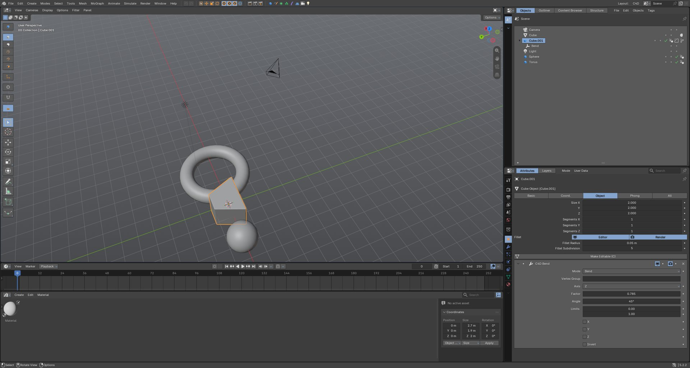

# C4D Feel

I've used Cinema 4D for years and wanted Blender to feel like home. This add-on makes Blender 5.2 work like C4D R24: the hotkeys, the managers, the menus, generators that work off their children, without taking anything away from Blender. Every Blender tool, menu and workspace is still there.

It runs on regular Blender 5.2. If you want the parts that need C++ changes (a real Object Manager with dots and tags, the big command palette), have a look at the fork: [Anaadh/blender4d](https://github.com/Anaadh/blender4d). There's a ready to run Windows build on its [releases page](https://github.com/Anaadh/blender4d/releases).

Not affiliated with Maxon or the Blender Foundation. Cinema 4D is a trademark of Maxon.

## Install

1. Grab the zip from [Releases](https://github.com/Anaadh/c4d-feel/releases).
2. In Blender: Edit > Preferences > Get Extensions, click the little arrow in the top right, Install from Disk, pick the zip.
3. In the add-on's preferences hit **Create C4D Workspace** and **Apply C4D Theme**.
4. Optional: File > Defaults > Save Startup File so it opens like that every time.

## What you get

**Hotkeys** (you can switch them off in the add-on prefs and get Blender's back)

- Alt + left/middle/right drag to orbit, pan, zoom. Hold 1/2/3 and drag to move/zoom/rotate the view, 4/5/6 to move/scale/rotate the selection.
- E / R / T for move, rotate, scale. Space goes back to the last tool. 8/9/0 for lasso, live and rectangle selection.
- The two-key commands: M~T extrude, M~S bevel, M~W inner extrude, U~L loop select, K~K knife and so on. Tap M (or U, K, N) and a little list pops up with the second key.
- C makes editable, Alt+G groups, Shift+G ungroups, Enter toggles model / point mode, H and S frame, F1-F5 switch views, F6-F9 for playback and keys.
- V opens a pie with the common stuff. Shift+C is the Commander (Blender's search).
- The things Blender keys used to do are still reachable. N~N for the sidebar, N~T for the toolbar, Tab still goes into edit mode.

**Layout**

- A "C4D" workspace: viewport on the left, Object Manager and Attribute Manager on the right, timeline and Material / Coordinate Manager at the bottom.
- C4D style menu bar (Create, Modes, Select, Tools, Mesh, MoGraph...) and command palette.
- Mode palette on top of Blender's toolbar (make editable, points / edges / polygons, enable axis, solo, snap).
- Object Manager with the editor/render dots, the generator check and tags. Blender's Outliner is one tab over if you want drag and drop.
- Attribute Manager with Basic / Coord. / Object / Phong tabs.
- Coordinate Manager with Object (Rel) / World and Size / Scale. Works on point selections in edit mode too.
- R24 colours.

**Objects**

- Parametric primitives: Cube (with fillet), Sphere, Cylinder, Cone, Plane, Torus, Pyramid. They stay editable until you press C.
- Splines: Circle, Rectangle, Star, Arc, Helix, Text.
- Extrude, Lathe, Sweep and Loft that use their child splines, like in C4D.
- Cloner (linear, radial, grid) with a random effector and a Plain effector you can move around.
- Deformers (bend, twist, taper, squash and stretch, wave) as child objects. Drag one under another object and the effect moves with it.
- Tags: Phong, Material, Target, Look at Camera, Align to Spline, Protection, Display, Compositing.

**Other bits**

- Double-click a material in the Material Manager and it opens in its own node window, styled to look like Redshift's shader graph.
- Look through a camera from the Object Manager (or Numpad 0) and navigating moves the camera, like C4D.
- Alt+R opens an interactive render region. Ctrl+B redraws the box.
- Render settings open in their own window.

## Things that don't work (yet, or ever)

- The Object Manager in this add-on is a list, so no drag and drop parenting there. Use the Outliner tab, Alt+G, or Ctrl+P. The fork fixes this properly.
- Palette icons are small because Blender headers have a fixed height. Again, the fork has a proper big palette row.
- No .c4d import. Blender can't read it, so export FBX, Alembic or USD out of C4D.
- No Xpresso, Takes or the full Fields system. Geometry Nodes covers a lot of that ground anyway.
- Icons are my own drawings, not Maxon's.

## Hacking on it

- `c4d_feel/` is the add-on itself.
- `tests/smoke_test.py` goes through every operator and manager. Run it with `blender --python tests/run_smoke.py`. It opens Blender, writes `tests/smoke_result.txt` and quits.
- `tools/make_icons.py` regenerates the icons.
- `tools/sync_to_fork.py` and `tools/build_fork.cmd` are for building blender4d with the add-on bundled in.
- Build the zip with `blender --command extension build --source-dir c4d_feel --output-dir dist`.

Bug reports and ideas are welcome, open an issue.

## License

GPL-3.0-or-later, same as Blender.
